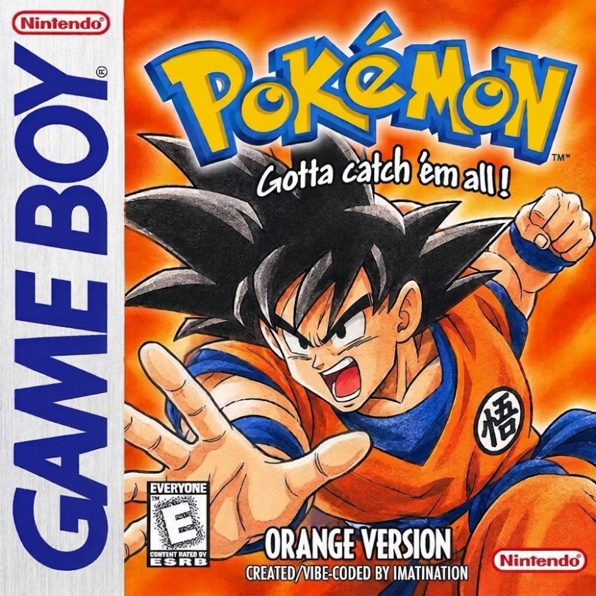

# Pokémon Orange Version

**Play in your browser:** https://imatination.github.io/Pokemon---Orange-Version/

Play as Goku in a Pokémon Red adventure. Fight alongside Vegeta (and, eventually, Frieza), ride the Flying Nimbus, train in the Gravity Room and take on the Elite Four.

## Features

- **Goku is the player.** He fights in battle himself, and Vegeta and Frieza join the team later.
- **Super Saiyan.** Goku unlocks it during the battle with Frieza. Press Select in the overworld to transform or switch the fighter shown.
- **Flying Nimbus.** Fly freely anywhere on the map. Land over water and you'll start surfing.
- **Special moves.** Goku, Vegeta and Frieza know Cut (Destructo Disk), Fly, Surf, Strength, Flash (Solar Flare) and Teleport (Instant Transmission) without needing badges.
- **Gravity Room.** Train your party at Capsule Corp to raise their levels and make them evolve.
- **Chapters.** Jump straight to: First Gym (Frieza), Vegeta Revenge, Nimbus, Gravity Room or Elite Four.
- **Auto-Battle.** Fights for you, switching out anyone who's about to faint.
- **Gary** returns as your rival with all three legendary birds.

## Controls

| | Keyboard | Phone |
|---|---|---|
| Move | Arrow keys | Slide your thumb on the D-pad |
| A / B | X / Z | A / B buttons |
| Start / Select | Enter / Shift | START / SELECT |
| Skip / fast-forward | Hold Space | ⏩ SKIP |
| Auto-Battle | B key | ⚔ AUTO |

**RESET** restarts the game and keeps your save. Save in-game as usual; your save is stored in your browser.

**On iPhone:** open the link in Safari, tap Share, then **Add to Home Screen** to play full screen.

## Files

| File | What it is |
|---|---|
| `index.html` | Loading page (light, so link previews work) |
| `game.html` | The game, playable in any browser (the ROM is built in) |
| `pokemon-orange-version.gbc` | The ROM, for a Game Boy flash cart or an emulator |
| `pokemon-orange-version-source.zip` | Source code (build with [rgbds](https://rgbds.gbdev.io): `make red`) |
| `share.jpg`, `cover.jpg`, `icon-*.png`, `apple-touch-icon.png`, `favicon.png`, `site.webmanifest` | Link preview, icons and home-screen app info |

## Credits

Created and vibe-coded by **Imatination** · © 2026 Imatination

Built on the [pret/pokered](https://github.com/pret/pokered) disassembly of Pokémon Red.

*A non-commercial fan project. It is not affiliated with or endorsed by Nintendo, Game Freak, The Pokémon Company, Toei Animation or Bird Studio/Shueisha. Pokémon and Dragon Ball are trademarks of their respective owners.*
